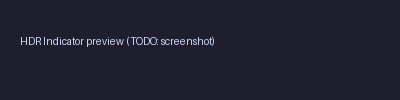

# dizziee.hdr-indicator

Shows an indicator in the Omarchy bar when HDR is active on any monitor.

## Installation

```sh
omarchy plugin add https://github.com/JJDizz1L/dizziee.hdr-indicator.git --enable
```

### Then place it in your bar layout with
`omarchy bar plugin add dizziee.hdr-indicator [--section <left|center|right>]`</br>

Suggested placement:
```
omarchy bar plugin add dizziee.hdr-indicator --section right
```

You can validate the plugin at any time with:

```sh
omarchy plugin validate ~/.config/omarchy/plugins/dizziee.hdr-indicator
```

## Updating

To pull the latest version of the plugin:

```sh
omarchy plugin update dizziee.hdr-indicator --yes
```

## Configuration

Configuration lives in `~/.config/omarchy/shell.json`.

No configurable options.

## Preview



## Uninstall

```sh
omarchy plugin remove dizziee.hdr-indicator
```

## License

MIT
